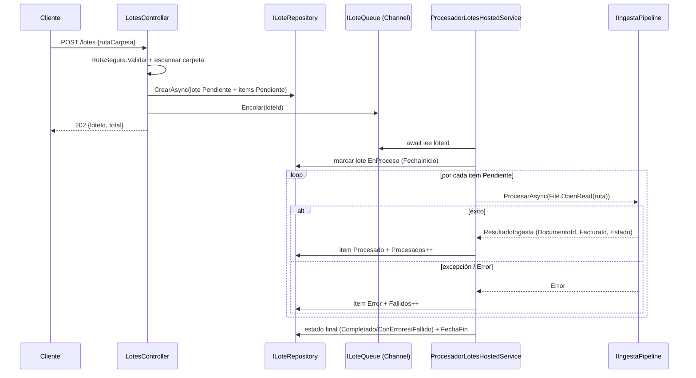

# 📁 Procesamiento por lotes desde carpeta (SDD)

> Nuevo caso de uso: dado el **path de una carpeta** del servidor, escanear los documentos que
> contiene y procesarlos **en segundo plano** por el pipeline de ingesta existente, con estado
> **persistido y consultable** vía API. Documento de diseño previo a la implementación.
> Fecha: 2026-09-03. Estado: **propuesta** (pendiente de aprobación).

---

## 1. Contexto y motivación

Hoy solo se puede ingerir documentos de uno en uno subiéndolos por HTTP
(`POST /documentos`, `IFormFile`). Para operar sobre volúmenes reales (una carpeta con decenas de
facturas ya depositadas en el servidor/NAS) hace falta un disparador que recorra un directorio y
alimente el pipeline sin intervención manual fichero a fichero.

El pipeline de extracción ya está desacoplado del transporte: `IIngestaPipeline.ProcesarAsync(Stream,
bool?, CancellationToken)` acepta cualquier `Stream`. Por tanto **el core no se toca**; solo añadimos
un nuevo punto de entrada (leer del sistema de ficheros en vez de un upload) y una capa de
**orquestación de lote** con estado persistido.

### Decisión de arquitectura ya tomada (contexto de esta SDD)

| Tema | Decisión | Motivo |
|---|---|---|
| Seguridad del path | **Raíz permitida configurable**; la ruta debe resolverse dentro de ella | Evita *path traversal* / lectura arbitraria del disco del servidor |
| Modelo de ejecución | **Asíncrono** con estado persistido y consultable | Cada documento tarda de segundos a ~16 s (LLM); un lote se va a minutos y rompería timeouts HTTP |
| Alcance del recorrido | **`*.pdf` + imágenes (`.jpg/.jpeg/.png`)**, **no recursivo** | Formatos que el pipeline ya soporta; la carpeta indicada, sin subcarpetas |
| Recuperación tras reinicio | **Opción A**: al arrancar, los lotes que quedaron `EnProceso` se marcan `Fallido` | Simple y suficiente; el reintento es relanzar la carpeta. La reanudación real (Opción B) queda como mejora futura |

---

## 2. Objetivos y no-objetivos

### Objetivos
- Endpoint `POST /lotes` que, dada una ruta de carpeta válida, **encola** un lote y devuelve `202` con su id.
- Procesamiento en segundo plano **dentro del proceso** de la API (sin dependencias nuevas), reutilizando `IIngestaPipeline`.
- Estado **persistido** en BD a nivel de lote y de cada documento, **consultable** por API (progreso, éxitos, errores).
- Tolerancia a fallos por documento: un PDF corrupto **no** aborta el lote.
- Seguridad: solo se procesan rutas **dentro de una raíz configurada**.

### No-objetivos (de esta iteración)
- **No** reanudar lotes a medias tras un reinicio (es la Opción B; aquí aplicamos la A).
- **No** subida de carpetas por HTTP ni watcher automático de carpeta (*hot folder*); el disparo es explícito.
- **No** recursividad en subcarpetas.
- **No** paralelismo entre documentos del mismo lote (se procesan en serie; el LLM ya es el cuello de botella y evitamos saturarlo).
- **No** mover/borrar/renombrar los ficheros de origen tras procesarlos.

---

## 3. Requisitos

### Funcionales
1. **RF-1** — `POST /lotes` recibe `{ "rutaCarpeta": "<ruta>" }`. Valida que exista, que esté dentro de la raíz permitida y que contenga ≥1 documento admitido. Crea el lote + sus items y lo encola. Devuelve `202` `{ loteId, totalDocumentos }`.
2. **RF-2** — Un worker en segundo plano procesa los items del lote **en serie**, invocando el pipeline por cada fichero.
3. **RF-3** — Por cada documento se registra resultado: `Procesado` (con `DocumentoId`/`FacturaId`/`Estado`) o `Error` (con mensaje).
4. **RF-4** — El lote mantiene contadores (`Procesados`, `Fallidos`) y un estado final: `Completado` (0 fallos), `CompletadoConErrores` (≥1 fallo, ≥1 éxito) o `Fallido` (0 éxitos / error irrecuperable).
5. **RF-5** — `GET /lotes/{id}` devuelve estado global y progreso. `GET /lotes/{id}/items` devuelve el detalle por documento.
6. **RF-6** — `GET /lotes` lista los lotes recientes (para un panel de control mínimo).

### No funcionales
- **RNF-1 (seguridad)** — Rechazar con `400`/`403` cualquier ruta fuera de la raíz permitida o con *traversal* (`..`). Validación por **path canónico**.
- **RNF-2 (robustez)** — Excepción en un documento → item a `Error`, el lote continúa.
- **RNF-3 (observabilidad)** — Log estructurado con `loteId` como correlación en cada paso (coherente con el patrón actual del pipeline).
- **RNF-4 (límites)** — Reaplicar el límite de tamaño por fichero (10 MB, hoy garantizado por `RequestSizeLimit` en el upload; al leer de disco hay que comprobarlo explícitamente).
- **RNF-5 (compatibilidad)** — Cero cambios en `ExtractorAgent`, `ValidadorAgent`, repositorio ni en el contrato `IIngestaPipeline`.

---

## 4. Diseño

### 4.1 Vista de componentes

```
POST /lotes ──► LotesController
                   │  valida ruta (RutaSegura) + escanea carpeta
                   ▼
             ILoteRepository.CrearAsync(lote + items)   ── SQL (nuevas tablas)
                   │
                   ▼
             ILoteQueue.Encolar(loteId)   ── Channel<int> en memoria
                                              │
   BackgroundService  ◄───────────────────────┘  (ProcesadorLotesHostedService)
        │  por cada item Pendiente:
        │    File.OpenRead(ruta) ─► IIngestaPipeline.ProcesarAsync(stream)
        │    actualiza LoteItem + contadores del Lote
        ▼
   GET /lotes/{id}, /lotes/{id}/items, /lotes  ◄── ILoteRepository (consulta)
```

### 4.2 Modelo de datos (2 tablas nuevas)

Mismo patrón que `FacturaStaging`: entidad en `Domain/Entities`, configuración `IEntityTypeConfiguration`
en `Infrastructure/Persistence/Configurations` (descubierta por `ApplyConfigurationsFromAssembly`), enums
persistidos como **string** (`.HasConversion<string>()`).

**`LoteProcesamiento`**

| Campo | Tipo | Notas |
|---|---|---|
| `Id` | int | PK identity |
| `RutaCarpeta` | string(500) | requerido |
| `Estado` | `EstadoLote` (enum→string) | `Pendiente/EnProceso/Completado/CompletadoConErrores/Fallido` |
| `TotalDocumentos` | int | nº de items creados al escanear |
| `Procesados` | int | contador éxitos |
| `Fallidos` | int | contador errores |
| `FechaCreacion` | DateTime | default `SYSUTCDATETIME()` |
| `FechaInicio` | DateTime? | al empezar el worker |
| `FechaFin` | DateTime? | al terminar |
| `MensajeError` | string? | error irrecuperable a nivel de lote (nvarchar(max)) |

**`LoteItem`**

| Campo | Tipo | Notas |
|---|---|---|
| `Id` | int | PK identity |
| `LoteId` | int | FK → `LoteProcesamiento`, **OnDelete=Cascade** |
| `NombreArchivo` | string(260) | nombre del fichero |
| `RutaArchivo` | string(500) | ruta absoluta resuelta |
| `Estado` | `EstadoLoteItem` (enum→string) | `Pendiente/Procesado/Error` |
| `DocumentoId` | Guid? | id del documento ingerido (si OK) |
| `FacturaId` | int? | id de `FacturaStaging` (si OK) |
| `EstadoFactura` | string? | `Estado` resultante de la factura (informativo) |
| `MensajeError` | string? | detalle si `Error` (nvarchar(max)) |
| `FechaProcesado` | DateTime? | cuándo se resolvió |

**Enums nuevos** (`Domain/Entities`):

```csharp
public enum EstadoLote { Pendiente, EnProceso, Completado, CompletadoConErrores, Fallido }
public enum EstadoLoteItem { Pendiente, Procesado, Error }
```

> Índices: `LoteItem(LoteId)` para las consultas de detalle; `LoteProcesamiento(Estado)` para la
> recuperación de arranque (Opción A) y el listado.

### 4.3 API

| Método | Ruta | Cuerpo / Query | Respuesta |
|---|---|---|---|
| `POST` | `/lotes` | `{ "rutaCarpeta": "D:\\facturas\\entrada" }` | `202` `{ loteId, totalDocumentos }` · `400` ruta inválida/vacía · `403` fuera de la raíz permitida |
| `GET` | `/lotes/{id:int}` | — | `200` `{ id, rutaCarpeta, estado, total, procesados, fallidos, fechaCreacion, fechaInicio, fechaFin }` · `404` |
| `GET` | `/lotes/{id:int}/items` | — | `200` `[{ nombreArchivo, estado, documentoId, facturaId, estadoFactura, mensajeError }]` · `404` |
| `GET` | `/lotes` | `?limit=50` | `200` lista de lotes recientes (resumen) |

Ejemplo de creación:

```
POST /lotes
{ "rutaCarpeta": "D:\\facturas\\entrada" }

202 Accepted
{ "loteId": 12, "totalDocumentos": 37 }
```

### 4.4 Secuencia del worker (por lote)



### 4.5 Seguridad del path (RutaSegura)

- Config nueva en `appsettings.json`:
  ```json
  "Lotes": {
    "RaizPermitida": "D:\\facturas"
  }
  ```
- Validación: `Path.GetFullPath(rutaCarpeta)` (canoniza y resuelve `..`) y comprobar que el resultado
  **empieza por** `Path.GetFullPath(RaizPermitida)` (comparación con separador final, `OrdinalIgnoreCase`
  en Windows). Si no, `403`. Si `RaizPermitida` no está configurada → el endpoint responde `403`
  (se desactiva por defecto; hay que optar explícitamente).
- Escaneo: `Directory.EnumerateFiles(ruta)` filtrando por extensión admitida (`.pdf/.jpg/.jpeg/.png`),
  **sin** `SearchOption.AllDirectories` (no recursivo).
- Por fichero: descartar (item `Error` "supera 10 MB") los que excedan `TamanoMaximoBytes`.

### 4.6 Recuperación tras reinicio — Opción A

En `Program.cs`, junto al `Database.Migrate()` de arranque, ejecutar un *saneo*:

```csharp
// Opción A: los lotes que quedaron a medias por un reinicio no se reanudan;
// se marcan Fallido para que el operador los relance.
await loteRepository.MarcarInterrumpidosComoFallidosAsync();
// UPDATE LoteProcesamiento SET Estado='Fallido', MensajeError='Interrumpido por reinicio', FechaFin=now
//   WHERE Estado IN ('Pendiente','EnProceso');
// UPDATE LoteItem SET Estado='Error', MensajeError='Interrumpido por reinicio'
//   WHERE Estado='Pendiente' AND LoteId IN (...);
```

> Nota: se ejecuta **antes** de aceptar tráfico, de modo que ningún lote quede `EnProceso` colgado.
> Es idempotente y barato.

---

## 5. Plan de implementación (archivos)

### Nuevos

| # | Archivo | Contenido |
|---|---|---|
| 1 | `Domain/Entities/LoteProcesamiento.cs` | Entidad lote |
| 2 | `Domain/Entities/LoteItem.cs` | Entidad item |
| 3 | `Domain/Entities/EstadoLote.cs` | Enum estado lote |
| 4 | `Domain/Entities/EstadoLoteItem.cs` | Enum estado item |
| 5 | `Domain/Contracts/ILoteRepository.cs` | `CrearAsync`, `ObtenerAsync`, `ListarAsync`, `TomarItemsPendientesAsync`, `ActualizarItemAsync`, `ActualizarLoteAsync`, `MarcarInterrumpidosComoFallidosAsync` |
| 6 | `Application/Lotes/ILoteQueue.cs` | Cola: `Encolar(int loteId)`, `IAsyncEnumerable<int> LeerAsync(ct)` |
| 7 | `Application/Lotes/RutaSegura.cs` | Validación de path contra raíz permitida (pura, testeable) |
| 8 | `Application/Lotes/LoteOptions.cs` | `RaizPermitida` (bind de `Lotes:`) |
| 9 | `Application/Lotes/EscaneadorCarpeta.cs` | Enumera ficheros admitidos + filtra por tamaño |
| 10 | `Infrastructure/Lotes/CanalLoteQueue.cs` | Implementación de `ILoteQueue` con `System.Threading.Channels` |
| 11 | `Infrastructure/Lotes/ProcesadorLotesHostedService.cs` | `BackgroundService`: lee cola, procesa items en serie con `IServiceScopeFactory` (scope por lote) |
| 12 | `Infrastructure/Persistence/LoteRepository.cs` | Implementación EF Core de `ILoteRepository` |
| 13 | `Infrastructure/Persistence/Configurations/LoteProcesamientoConfiguration.cs` | Fluent API |
| 14 | `Infrastructure/Persistence/Configurations/LoteItemConfiguration.cs` | Fluent API |
| 15 | `Api/Controllers/LotesController.cs` | Endpoints `POST/GET` |
| 16 | Migración EF `AddProcesamientoLotes` | `dotnet ef migrations add AddProcesamientoLotes` |

### Modificados

| Archivo | Cambio |
|---|---|
| `Infrastructure/Persistence/DocFlowDbContext.cs` | Añadir `DbSet<LoteProcesamiento>` y `DbSet<LoteItem>` |
| `Infrastructure/DependencyInjection.cs` | Registrar `ILoteRepository`, `ILoteQueue` (**Singleton**, la cola vive con el proceso), `AddHostedService<ProcesadorLotesHostedService>()` |
| `Application/DependencyInjection.cs` | `services.Configure<LoteOptions>(...)` y registrar `EscaneadorCarpeta`/`RutaSegura` si se inyectan |
| `Api/Program.cs` | Tras `Database.Migrate()`: llamar `MarcarInterrumpidosComoFallidosAsync()` (Opción A) |
| `Api/appsettings.json` | Sección `"Lotes": { "RaizPermitida": "" }` |
| `docs/arquitectura.md` | Referenciar el nuevo flujo de lotes (breve) |

### Notas de implementación clave
- **Scope por lote**: el `BackgroundService` es *singleton*; para usar `IIngestaPipeline`/repositorios
  (que son *scoped*) debe crear un `IServiceScope` por lote con `IServiceScopeFactory`.
- **Cola singleton, no persistente**: `Channel<int>` en memoria. Si el proceso cae, la cola se pierde
  → cubierto por la Opción A (los `Pendiente`/`EnProceso` pasan a `Fallido` al arrancar).
- **Serie, no paralelo**: procesar items uno a uno evita saturar el LLM y simplifica los contadores.
- **`CancellationToken`**: encadenar el `stoppingToken` del hosted service hasta el pipeline para un
  apagado limpio.

---

## 6. Pruebas

| Nivel | Caso |
|---|---|
| Unit | `RutaSegura`: acepta dentro de la raíz; rechaza `..`, ruta absoluta fuera, raíz no configurada |
| Unit | `EscaneadorCarpeta`: filtra extensiones, ignora subcarpetas, descarta >10 MB |
| Unit | `LoteRepository`: crear lote+items, actualizar contadores, `MarcarInterrumpidos...` (con SQLite in-memory o el patrón de tests actual) |
| Integración | Carpeta temporal con 2 PDFs válidos + 1 corrupto → lote `CompletadoConErrores`, 2 `Procesado` + 1 `Error` (pipeline mockeado) |
| Integración | Reinicio simulado: lote `EnProceso` en BD → tras el saneo de arranque queda `Fallido` |

> Los agentes LLM se mockean en las pruebas de integración (igual que hoy): se testea la **orquestación
> del lote**, no el LLM.

---

## 7. Riesgos y mitigaciones

| Riesgo | Mitigación |
|---|---|
| Lectura arbitraria del disco del servidor | Raíz permitida + validación por path canónico (RNF-1); desactivado si no se configura |
| Lote colgado en `EnProceso` tras caída | Opción A: saneo idempotente en el arranque |
| Un documento pesado/corrupto bloquea el lote | Try/catch por item + timeout del LLM (ya a 5 min); item a `Error` y se continúa |
| Reprocesar la misma carpeta duplica facturas | El índice único `(ProveedorId, NumeroFactura)` vivo ya lo impide; el item quedará `Error` con el motivo |
| Saturación del LLM | Procesamiento en serie (no-objetivo el paralelismo en esta fase) |

---

## 8. Trabajo futuro (fuera de alcance)

- **Opción B (reanudación)**: al arrancar, reencolar lotes `EnProceso` y continuar por los items
  `Pendiente` (seguro por el índice único). Sustituiría al saneo de la Opción A.
- **Hot folder**: `FileSystemWatcher` que cree lotes automáticamente al detectar ficheros nuevos.
- **Paralelismo controlado** entre documentos (con un límite acorde al proveedor LLM).
- **Acciones post-proceso**: mover los ficheros procesados a `procesados/` o `errores/`.
